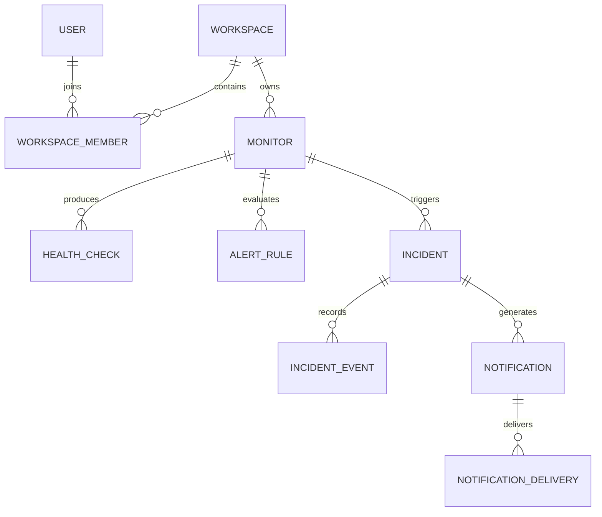

# Database Design

## Document control
- Product: API Monitoring Dashboard
- Version: 1.0 (MVP baseline)
- Status: Implementation-ready baseline; decisions requiring deployment-specific values are marked as configuration.
- Audience: Product, frontend, backend, QA, DevOps, security, and AI coding agents.
- Normative language: **MUST** is mandatory; **SHOULD** is recommended; **MAY** is optional.

## Product invariants
1. Monitoring executes on the server through workers; a browser session is never required.
2. A health check is an immutable observation. Corrections are represented by new records, not edits to history.
3. Every resource query is scoped to the authenticated user's workspace.
4. A check result, endpoint status, incident transition, and notification are separate concepts.
5. All times are stored in UTC and rendered in the user's selected timezone (default browser timezone).
6. Secrets are never returned in API responses or written to ordinary application logs.
7. A monitor must not be allowed to use the service as an unrestricted network proxy. SSRF controls are mandatory before any outbound request.
8. MVP prioritizes deterministic, explainable rules over machine-learning-based anomaly detection.

## Assumptions and decisions register
| ID | Decision | Rationale / implementation |
|---|---|---|
| ADR-001 | Multi-tenant workspace model | Every user belongs to one or more workspaces; all domain records carry `workspaceId`. |
| ADR-002 | MongoDB is the system of record | Mongoose schemas; indexes and retention jobs support query patterns. |
| ADR-003 | Redis + BullMQ for scheduling and execution | Durable queues, retries, concurrency limits, and independent workers. |
| ADR-004 | One scheduled job per active monitor | Scheduler enqueues due monitor IDs; worker re-reads current config before execution. |
| ADR-005 | Endpoint status uses recent-check policy | Configurable consecutive failures and latency threshold; exact defaults below. |
| ADR-006 | JWT access token + refresh-token rotation | Short-lived access token; hashed refresh token persisted and revocable. |
| ADR-007 | Socket.IO is an enhancement, REST remains authoritative | UI must recover by refetching REST data after reconnect. |
| ADR-008 | Email is MVP external notification channel | In-app notifications are always persisted; email depends on verified SMTP configuration. |
| ADR-009 | Retention defaults are configurable | MVP defaults: raw checks 30 days; incidents and audit events 1 year. |
| ADR-010 | No arbitrary scripting or user-supplied code in monitors | Avoids execution risk and keeps request semantics auditable. |

## MVP scope and exclusions
**MVP includes:** account/workspace access, endpoint CRUD, safe HTTP checks, configurable intervals/timeouts, history, dashboard, analytics, threshold-based anomaly detection, alert rules, incidents, in-app notifications, email notifications, audit trail, tests, and deployable environments.

**Not in MVP:** public status pages, on-call schedules, SMS/push, Slack/Discord, SSO/SAML, billing, multi-region probes, synthetic browser journeys, user-defined scripts, ML forecasting, and customer-managed agents. These must not block MVP delivery.

## Global configuration baseline
| Setting | Default | Validation |
|---|---:|---|
| `MONITOR_INTERVAL_SECONDS` | 60 | 30–3600; workspace plan limits may apply |
| `MONITOR_TIMEOUT_MS` | 10000 | 1000–30000 |
| `MAX_RESPONSE_BYTES` | 1048576 | hard cap; do not buffer unlimited bodies |
| `MAX_REDIRECTS` | 0 | redirects disabled by default |
| `FAILURES_TO_DOWN` | 3 | 1–10 consecutive failures |
| `LATENCY_DEGRADED_MS` | 2000 | configurable per monitor |
| `ANALYTICS_DEFAULT_RANGE_DAYS` | 7 | allowed range 1–90 |
| `CHECK_RETENTION_DAYS` | 30 | configurable operational limit |
| `INCIDENT_RETENTION_DAYS` | 365 | subject to legal/customer policy |
| `NOTIFICATION_COOLDOWN_MINUTES` | 15 | per alert rule and incident fingerprint |

## Cross-document traceability
- Requirements use `FR-*` and `NFR-*` identifiers.
- API operations use `API-*`; data entities use `DATA-*`; UI components use `UI-*`.
- Acceptance criteria use `AC-*` and refer back to requirements.
- Security controls use `SEC-*`; test cases use `TC-*`.
- A requirement is not considered complete until its acceptance criteria and test evidence are linked.

## 1. Data model overview
MongoDB collections are workspace-scoped. ObjectIds are used for internal identifiers. Store timestamps as BSON Date in UTC. All schemas use `createdAt` and `updatedAt` where mutable; immutable event/check records use `createdAt` only.

## 2. Entity definitions
### DATA-USER: `users`
`_id`, `email` (normalized, unique), `passwordHash`, `name`, `emailVerifiedAt`, `status`, `createdAt`, `updatedAt`.
Indexes: unique `{email:1}`.

### DATA-WORKSPACE: `workspaces`
`_id`, `name`, `slug`, `createdBy`, `plan`, `settings`, `createdAt`, `updatedAt`.
Indexes: unique `{slug:1}`.

### DATA-MEMBERSHIP: `workspaceMembers`
`_id`, `workspaceId`, `userId`, `role` (`owner|admin|member|viewer`), `status`, `joinedAt`.
Indexes: unique `{workspaceId:1,userId:1}`, `{userId:1,status:1}`.

### DATA-MONITOR: `monitors`
`_id`, `workspaceId`, `name`, `url`, `normalizedHost`, `method`, `intervalSeconds`, `timeoutMs`, `expectedStatusCodes[]`, `headersEncrypted`, `bodyEncrypted`, `bodyContentType`, `active`, `status`, `lastStatus`, `lastCheckedAt`, `nextRunAt`, `lastLatencyMs`, `consecutiveFailures`, `recentSuccessRatio`, `latencyThresholdMs`, `createdBy`, `createdAt`, `updatedAt`, `deletedAt`.
Indexes: `{workspaceId:1,active:1,nextRunAt:1}`, `{workspaceId:1,status:1}`, `{workspaceId:1,createdAt:-1}`.
Soft-delete is optional; deleted monitors must never be scheduled.

### DATA-CHECK: `healthChecks`
`_id`, `workspaceId`, `monitorId`, `scheduledAt`, `startedAt`, `completedAt`, `outcome`, `statusCode`, `latencyMs`, `errorCategory`, `errorMessageSafe`, `responseBytes`, `traceId`, `createdAt`.
Indexes: `{workspaceId:1,monitorId:1,completedAt:-1}`, `{workspaceId:1,completedAt:-1}`, TTL `{createdAt:1}` based on configured retention. Do not store response bodies by default.

### DATA-ALERT-RULE: `alertRules`
`_id`, `workspaceId`, `monitorId|null`, `name`, `enabled`, `conditionType`, `operator`, `threshold`, `consecutiveCount`, `windowSize`, `severity`, `channels[]`, `cooldownMinutes`, `createdAt`, `updatedAt`.
Indexes: `{workspaceId:1,enabled:1}`, `{workspaceId:1,monitorId:1}`.

### DATA-INCIDENT: `incidents`
`_id`, `workspaceId`, `monitorId`, `alertRuleId`, `fingerprint`, `title`, `description`, `conditionType`, `severity`, `status`, `openedAt`, `acknowledgedAt`, `investigatingAt`, `resolvedAt`, `resolvedBy`, `resolutionNote`, `lastTriggeredAt`, `createdAt`, `updatedAt`.
Indexes: unique partial `{workspaceId:1,fingerprint:1,status:1}` for active statuses (implementation must ensure only one active incident per fingerprint); `{workspaceId:1,status:1,openedAt:-1}`, `{workspaceId:1,severity:1,openedAt:-1}`.

### DATA-INCIDENT-EVENT: `incidentEvents`
`_id`, `workspaceId`, `incidentId`, `actorType` (`user|system`), `actorId|null`, `eventType`, `message`, `metadataSafe`, `createdAt`.
Indexes: `{workspaceId:1,incidentId:1,createdAt:1}`.

### DATA-NOTIFICATION: `notifications`
`_id`, `workspaceId`, `userId`, `incidentId|null`, `type`, `title`, `message`, `readAt`, `createdAt`.
Indexes: `{workspaceId:1,userId:1,readAt:1,createdAt:-1}`.

### DATA-DELIVERY: `notificationDeliveries`
`_id`, `workspaceId`, `notificationId`, `channel`, `destinationMasked`, `status`, `attemptCount`, `nextAttemptAt`, `lastErrorSafe`, `sentAt`, `createdAt`, `updatedAt`.
Indexes: `{status:1,nextAttemptAt:1}`, `{workspaceId:1,createdAt:-1}`.

### DATA-REFRESH-TOKEN: `refreshTokens`
`_id`, `userId`, `tokenHash`, `familyId`, `expiresAt`, `revokedAt`, `createdAt`.
Indexes: unique `{tokenHash:1}`, TTL `{expiresAt:1}`.

### DATA-AUDIT: `auditEvents`
`_id`, `workspaceId`, `actorId`, `action`, `resourceType`, `resourceId`, `metadataSafe`, `ipHash`, `createdAt`.
Indexes: `{workspaceId:1,createdAt:-1}`, TTL per retention policy.

## 3. Relationships

## 4. Consistency and transactions
- Create workspace and owner membership in one transaction.
- Create incident and initial incident event in one transaction where supported.
- Use atomic `findOneAndUpdate`/upsert with fingerprint to prevent duplicate active incidents.
- Health check persistence and monitor summary update should be coordinated; if not transactional, use idempotent job key and reconciliation job.
- Never rely on client-provided workspace IDs without verifying membership.

## 5. Retention and archival
- Default health check retention 30 days, incident/event/audit retention 365 days.
- TTL deletion is asynchronous; do not promise exact deletion time.
- Keep operational rollups in future phase if raw data query cost becomes high.
- Deletion workflow must first deactivate monitor and cancel pending jobs, then remove or anonymize related data according to retention/legal policy.

## 6. Data protection
Encrypt sensitive headers and request body fields using authenticated encryption (AES-256-GCM or managed KMS). Store key version and nonce/tag. Redact authorization, cookie, API-key, and custom sensitive headers from logs. Do not store response payloads unless explicitly enabled with strict size and redaction policy.
