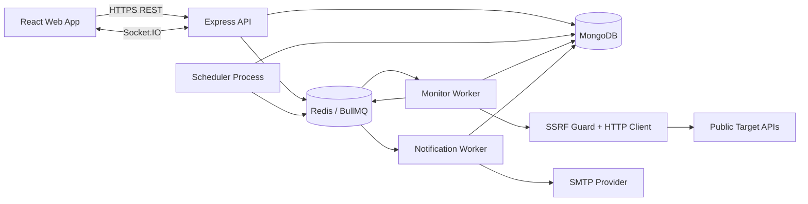

# System Architecture

## Document control
- Product: API Monitoring Dashboard
- Version: 1.0 (MVP baseline)
- Status: Implementation-ready baseline; decisions requiring deployment-specific values are marked as configuration.
- Audience: Product, frontend, backend, QA, DevOps, security, and AI coding agents.
- Normative language: **MUST** is mandatory; **SHOULD** is recommended; **MAY** is optional.

## Product invariants
1. Monitoring executes on the server through workers; a browser session is never required.
2. A health check is an immutable observation. Corrections are represented by new records, not edits to history.
3. Every resource query is scoped to the authenticated user's workspace.
4. A check result, endpoint status, incident transition, and notification are separate concepts.
5. All times are stored in UTC and rendered in the user's selected timezone (default browser timezone).
6. Secrets are never returned in API responses or written to ordinary application logs.
7. A monitor must not be allowed to use the service as an unrestricted network proxy. SSRF controls are mandatory before any outbound request.
8. MVP prioritizes deterministic, explainable rules over machine-learning-based anomaly detection.

## Assumptions and decisions register
| ID | Decision | Rationale / implementation |
|---|---|---|
| ADR-001 | Multi-tenant workspace model | Every user belongs to one or more workspaces; all domain records carry `workspaceId`. |
| ADR-002 | MongoDB is the system of record | Mongoose schemas; indexes and retention jobs support query patterns. |
| ADR-003 | Redis + BullMQ for scheduling and execution | Durable queues, retries, concurrency limits, and independent workers. |
| ADR-004 | One scheduled job per active monitor | Scheduler enqueues due monitor IDs; worker re-reads current config before execution. |
| ADR-005 | Endpoint status uses recent-check policy | Configurable consecutive failures and latency threshold; exact defaults below. |
| ADR-006 | JWT access token + refresh-token rotation | Short-lived access token; hashed refresh token persisted and revocable. |
| ADR-007 | Socket.IO is an enhancement, REST remains authoritative | UI must recover by refetching REST data after reconnect. |
| ADR-008 | Email is MVP external notification channel | In-app notifications are always persisted; email depends on verified SMTP configuration. |
| ADR-009 | Retention defaults are configurable | MVP defaults: raw checks 30 days; incidents and audit events 1 year. |
| ADR-010 | No arbitrary scripting or user-supplied code in monitors | Avoids execution risk and keeps request semantics auditable. |

## MVP scope and exclusions
**MVP includes:** account/workspace access, endpoint CRUD, safe HTTP checks, configurable intervals/timeouts, history, dashboard, analytics, threshold-based anomaly detection, alert rules, incidents, in-app notifications, email notifications, audit trail, tests, and deployable environments.

**Not in MVP:** public status pages, on-call schedules, SMS/push, Slack/Discord, SSO/SAML, billing, multi-region probes, synthetic browser journeys, user-defined scripts, ML forecasting, and customer-managed agents. These must not block MVP delivery.

## Global configuration baseline
| Setting | Default | Validation |
|---|---:|---|
| `MONITOR_INTERVAL_SECONDS` | 60 | 30–3600; workspace plan limits may apply |
| `MONITOR_TIMEOUT_MS` | 10000 | 1000–30000 |
| `MAX_RESPONSE_BYTES` | 1048576 | hard cap; do not buffer unlimited bodies |
| `MAX_REDIRECTS` | 0 | redirects disabled by default |
| `FAILURES_TO_DOWN` | 3 | 1–10 consecutive failures |
| `LATENCY_DEGRADED_MS` | 2000 | configurable per monitor |
| `ANALYTICS_DEFAULT_RANGE_DAYS` | 7 | allowed range 1–90 |
| `CHECK_RETENTION_DAYS` | 30 | configurable operational limit |
| `INCIDENT_RETENTION_DAYS` | 365 | subject to legal/customer policy |
| `NOTIFICATION_COOLDOWN_MINUTES` | 15 | per alert rule and incident fingerprint |

## Cross-document traceability
- Requirements use `FR-*` and `NFR-*` identifiers.
- API operations use `API-*`; data entities use `DATA-*`; UI components use `UI-*`.
- Acceptance criteria use `AC-*` and refer back to requirements.
- Security controls use `SEC-*`; test cases use `TC-*`.
- A requirement is not considered complete until its acceptance criteria and test evidence are linked.

## 1. Architecture style
Use a modular monolith for the API with independently deployable worker processes. This is simpler than microservices for MVP while separating latency-sensitive web requests from scheduled monitoring execution.

## 2. Logical architecture

## 3. Trust boundaries
- Browser to API: untrusted input; validate all fields and enforce auth.
- API to database: server-side access; tenant scope mandatory.
- Worker to internet: high-risk egress boundary; SSRF guard and network firewall required.
- Notification worker to SMTP: credentials isolated from web process where possible.
- Socket events: workspace-scoped, safe payloads, membership checked.

## 4. Module responsibilities
- `auth`: registration, login, token rotation, session revocation.
- `workspaces`: membership and role enforcement.
- `monitors`: CRUD, validation, pause/resume.
- `monitoring`: scheduling, safe HTTP execution, check persistence, status derivation.
- `analytics`: aggregation and percentile calculations.
- `alerts`: rule evaluation and cooldown.
- `incidents`: fingerprint upsert, state transitions, timeline.
- `notifications`: in-app records and email delivery.
- `audit`: security-relevant actions.
- `realtime`: workspace room authentication and event emission.

## 5. Scheduling and idempotency
Scheduler polls due active monitors in batches using `nextRunAt <= now`, sorted by due time. Enqueue deterministic job ID `check:<monitorId>:<scheduledMinute>`; update `nextRunAt` with a compare-and-set condition. Worker re-fetches monitor, validates current active state, and uses a distributed lock with bounded TTL. Use a unique check execution key to prevent duplicate history rows after retry.

## 6. Failure isolation
- API can continue serving read requests if worker is down; show last check time and monitoring service warning.
- Worker failures must not crash API process.
- Email provider failures do not prevent incident persistence.
- Redis unavailable means scheduling pauses; health endpoint reports degraded dependency state.
- Mongo unavailable means no false success; health-check writes and domain transitions fail/retry.

## 7. Scaling path
MVP: one API deployment, one scheduler replica with leader lock, configurable worker replicas, shared Mongo/Redis. Later: sharded queues by workspace/region, read replicas, rollup collections, multiple probe regions, event streaming. Do not add microservices until operational bottlenecks justify them.

## 8. Deployment topology
Separate web, API, scheduler, worker, and notification worker process types. They may share one container image with different start commands. Use managed MongoDB and Redis, private network access where available, TLS for all public endpoints, secrets manager, health/readiness probes, and graceful shutdown.
