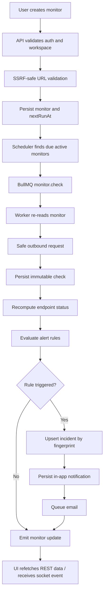
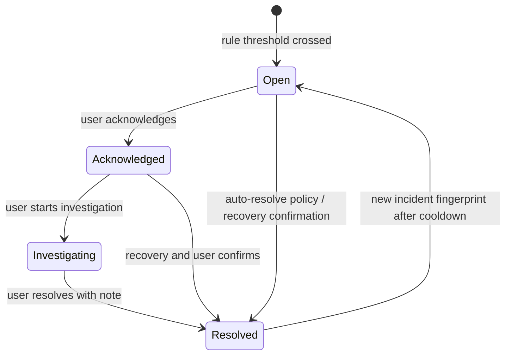

# Application Workflow and Business Process

## Document control
- Product: API Monitoring Dashboard
- Version: 1.0 (MVP baseline)
- Status: Implementation-ready baseline; decisions requiring deployment-specific values are marked as configuration.
- Audience: Product, frontend, backend, QA, DevOps, security, and AI coding agents.
- Normative language: **MUST** is mandatory; **SHOULD** is recommended; **MAY** is optional.

## Product invariants
1. Monitoring executes on the server through workers; a browser session is never required.
2. A health check is an immutable observation. Corrections are represented by new records, not edits to history.
3. Every resource query is scoped to the authenticated user's workspace.
4. A check result, endpoint status, incident transition, and notification are separate concepts.
5. All times are stored in UTC and rendered in the user's selected timezone (default browser timezone).
6. Secrets are never returned in API responses or written to ordinary application logs.
7. A monitor must not be allowed to use the service as an unrestricted network proxy. SSRF controls are mandatory before any outbound request.
8. MVP prioritizes deterministic, explainable rules over machine-learning-based anomaly detection.

## Assumptions and decisions register
| ID | Decision | Rationale / implementation |
|---|---|---|
| ADR-001 | Multi-tenant workspace model | Every user belongs to one or more workspaces; all domain records carry `workspaceId`. |
| ADR-002 | MongoDB is the system of record | Mongoose schemas; indexes and retention jobs support query patterns. |
| ADR-003 | Redis + BullMQ for scheduling and execution | Durable queues, retries, concurrency limits, and independent workers. |
| ADR-004 | One scheduled job per active monitor | Scheduler enqueues due monitor IDs; worker re-reads current config before execution. |
| ADR-005 | Endpoint status uses recent-check policy | Configurable consecutive failures and latency threshold; exact defaults below. |
| ADR-006 | JWT access token + refresh-token rotation | Short-lived access token; hashed refresh token persisted and revocable. |
| ADR-007 | Socket.IO is an enhancement, REST remains authoritative | UI must recover by refetching REST data after reconnect. |
| ADR-008 | Email is MVP external notification channel | In-app notifications are always persisted; email depends on verified SMTP configuration. |
| ADR-009 | Retention defaults are configurable | MVP defaults: raw checks 30 days; incidents and audit events 1 year. |
| ADR-010 | No arbitrary scripting or user-supplied code in monitors | Avoids execution risk and keeps request semantics auditable. |

## MVP scope and exclusions
**MVP includes:** account/workspace access, endpoint CRUD, safe HTTP checks, configurable intervals/timeouts, history, dashboard, analytics, threshold-based anomaly detection, alert rules, incidents, in-app notifications, email notifications, audit trail, tests, and deployable environments.

**Not in MVP:** public status pages, on-call schedules, SMS/push, Slack/Discord, SSO/SAML, billing, multi-region probes, synthetic browser journeys, user-defined scripts, ML forecasting, and customer-managed agents. These must not block MVP delivery.

## Global configuration baseline
| Setting | Default | Validation |
|---|---:|---|
| `MONITOR_INTERVAL_SECONDS` | 60 | 30–3600; workspace plan limits may apply |
| `MONITOR_TIMEOUT_MS` | 10000 | 1000–30000 |
| `MAX_RESPONSE_BYTES` | 1048576 | hard cap; do not buffer unlimited bodies |
| `MAX_REDIRECTS` | 0 | redirects disabled by default |
| `FAILURES_TO_DOWN` | 3 | 1–10 consecutive failures |
| `LATENCY_DEGRADED_MS` | 2000 | configurable per monitor |
| `ANALYTICS_DEFAULT_RANGE_DAYS` | 7 | allowed range 1–90 |
| `CHECK_RETENTION_DAYS` | 30 | configurable operational limit |
| `INCIDENT_RETENTION_DAYS` | 365 | subject to legal/customer policy |
| `NOTIFICATION_COOLDOWN_MINUTES` | 15 | per alert rule and incident fingerprint |

## Cross-document traceability
- Requirements use `FR-*` and `NFR-*` identifiers.
- API operations use `API-*`; data entities use `DATA-*`; UI components use `UI-*`.
- Acceptance criteria use `AC-*` and refer back to requirements.
- Security controls use `SEC-*`; test cases use `TC-*`.
- A requirement is not considered complete until its acceptance criteria and test evidence are linked.

## 1. System-level flow

## 2. Monitor creation workflow
1. UI collects required fields: name, URL, method, interval, timeout, expected status codes.
2. Client-side Zod validation checks formatting and basic bounds; this is usability only.
3. API authenticates user and resolves active workspace membership.
4. API validates URL syntax, scheme, credentials absence, port, DNS/IP safety, and policy.
5. Sensitive headers are encrypted; non-sensitive configuration is normalized.
6. Monitor is created with `status=Unknown`, `lastCheckedAt=null`, `nextRunAt=now`.
7. Scheduler picks up the monitor within one scheduler tick and enqueues the initial check.
8. UI shows “Waiting for first check”; do not present Unknown as Down.

## 3. Health-check execution workflow
- Worker verifies monitor is still active and belongs to a valid workspace.
- Acquire lock; if another check is active, mark current job as skipped/idempotently complete.
- Revalidate DNS and destination immediately before connecting.
- Execute with timeout, no redirects, response cap, and sanitized headers.
- Outcome classification:
  - `success`: response status matches expected status list.
  - `http_error`: response received but status unexpected.
  - `timeout`: deadline exceeded.
  - `network_error`: connection/DNS failure.
  - `tls_error`: certificate/handshake failure.
  - `blocked`: security policy denied request.
- Persist check; update consecutive failure count and status.
- Evaluate all enabled alert rules for that monitor.
- Emit workspace-scoped socket event after persistence.

## 4. Status state machine

```mermaid
stateDiagram-v2
  [*] --> Unknown
  Unknown --> Operational: first successful check
  Unknown --> Down: failures reach threshold
  Operational --> Degraded: latency or rolling success threshold breached
  Operational --> Down: consecutive failures reach threshold
  Degraded --> Operational: healthy recovery window
  Degraded --> Down: failure threshold reached
  Down --> Operational: recovery checks pass
  Down --> Degraded: check succeeds but latency remains high
  Operational --> Paused: user pauses
  Degraded --> Paused: user pauses
  Down --> Paused: user pauses
  Paused --> Unknown: resumed; awaiting new check
```

Pause overrides computed health; resume resets visible status to Unknown until a fresh observation.

## 5. Incident lifecycle

Do not reopen a resolved incident silently. A new sustained failure after recovery/cooldown creates a new incident with a link to the previous incident.

## 6. Alert evaluation rules
- Failure alert: consecutive failures ≥ configured threshold.
- Latency alert: rolling P95 or latest latency exceeds threshold for N consecutive successful checks.
- Error-rate alert: failure percentage over a minimum sample window exceeds configured percentage.
- Recovery: configured number of consecutive successful checks below latency threshold.
- Deduplication key: `workspaceId:monitorId:ruleId:conditionType`.
- Cooldown suppresses repeated notifications, not incident data updates.
- Store `lastTriggeredAt`, `lastNotifiedAt`, and suppression reason.

## 7. Failure and retry handling
- Worker process crash: BullMQ retries job with exponential backoff; job identity prevents duplicate check creation.
- Target timeout: record timeout result; do not queue repeated immediate retries.
- Redis outage: API may accept monitor changes only if persistence succeeds; scheduler pauses enqueue and reports degraded service.
- SMTP outage: retain notification record and retry with bounded attempts; do not roll back incident creation.
- Socket disconnect: client reconnects and refetches relevant REST queries.
- Mongo outage: do not acknowledge successful check persistence; retry safely.

## 8. User-visible workflows
- Dashboard: summary cards → endpoint status list → recent incidents.
- Monitor detail: overview → history → analytics → configuration.
- Incidents: filter by status/severity → detail timeline → acknowledge/investigate/resolve.
- Alerts: create rule → choose condition and threshold → choose channels → test configuration.
